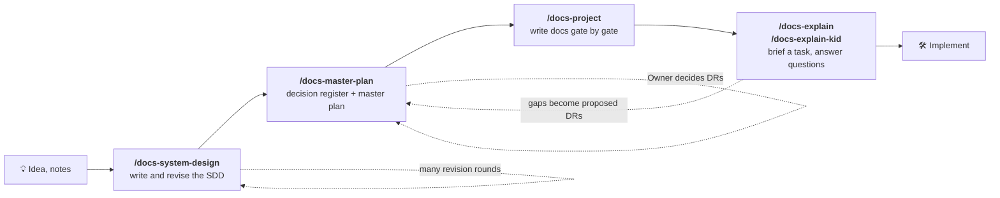

<div align="center">

# design-docs-skills

**From an idea to a documentation set you can implement without asking.**

Five agent skills for Claude Code (and other agents) that write the system design, turn its gaps into decisions, produce gated project docs, and brief the developers who build from them.

[](https://github.com/ninggiangboy/design-docs-skills/actions/workflows/validate.yml)
[](LICENSE)


[Quick start](#quick-start) · [The skills](#the-skills) · [Walkthrough](#walkthrough) · [Languages](#languages) · [Method](#method) · [Development](#development)

</div>

---

## Why

Design docs usually fail in one of two ways: they stop at a high-level SDD that leaves every hard question open, or they grow into a pile of documents nobody can trace back to a decision. These skills take one path through the whole process:

- **Nothing is decided silently.** Every place the design does not say *exactly how* becomes a numbered decision (DR) with a proposed option, waiting for the Owner.
- **Nothing starts before its docs are ready.** Each phase has a gate: its tasks begin only when the documents they need are `Approved`.
- **Nothing is guessed.** When a developer asks something the docs do not answer, the skill says so, offers options, and records the gap.

## How it works



## Quick start

Requires [Node.js](https://nodejs.org) for `npx` and Python 3.10+ for the bundled checker scripts.

```bash
npx skills add ninggiangboy/design-docs-skills -g -a claude-code
```

Then, in Claude Code:

```text
/docs-system-design An inventory system for a chain of stores, focused on
keeping stock consistent between branches while offline.
```

<details>
<summary><b>More install options</b></summary>

```bash
# Only for the current project (.claude/skills/), committed with the repo
npx skills add ninggiangboy/design-docs-skills -a claude-code

# Pick individual skills
npx skills add ninggiangboy/design-docs-skills --skill docs-system-design

# List the skills in this repository
npx skills add ninggiangboy/design-docs-skills --list

# Update, remove
npx skills update
npx skills remove docs-system-design docs-master-plan docs-project docs-explain docs-explain-kid
```

`npx skills` also installs for other agents (Codex, Cursor, OpenCode, Gemini CLI…): drop `-a claude-code` to choose from a list.

Manual install:

```bash
git clone https://github.com/ninggiangboy/design-docs-skills.git
cp -r design-docs-skills/skills/* ~/.claude/skills/
```

</details>

## The skills

| | Skill | Input | Output |
| :-: | --- | --- | --- |
| 1 | [`docs-system-design`](skills/docs-system-design/SKILL.md) | An idea, notes, or an existing SDD | `<project>-sdd.md`, revised over many turns in the same session |
| 2 | [`docs-master-plan`](skills/docs-master-plan/SKILL.md) | The SDD | Decision register, master plan, docs index |
| 3 | [`docs-project`](skills/docs-project/SKILL.md) | The master plan and decision register | `DOC-xx` documents, ADRs, runbooks, experiments, screen specs… |
| 4 | [`docs-explain`](skills/docs-explain/SKILL.md) | A task, feature, flow, endpoint or screen, plus questions | A task brief in chat and cited answers |
| 5 | [`docs-explain-kid`](skills/docs-explain-kid/SKILL.md) | The same, for a junior developer | The same facts, explained from zero |

<details>
<summary><b>What each skill produces, in detail</b></summary>

**`docs-system-design`** writes the SDD: context, core problem, investment per module, scope, requirements, architecture, deep domain sections (invariants, state machines, races, options analysis), data, API, UI, fault tolerance, experiments, plan and risks. Every follow-up message in the session re-reads the file, edits minimally, and updates everything the change affects.

**`docs-master-plan`** reads the SDD and writes:

- `docs/00-decision-register.md`: every gap in the SDD as a DR with a proposed option;
- `docs/00-master-plan.md`: documents to write with their required content and gate, tasks per phase with acceptance criteria, and a traceability matrix;
- `docs/README.md`: the index of the docs tree.

**`docs-project`** writes, reviews and tracks each document defined by the plan, following its required content and gate, using decided DRs, and recording new decisions as DRs.

**`docs-explain`** builds a brief for the developer about to implement something: what and why, what done means, what to read first, how it works step by step, contracts (endpoints, tables, configuration, errors), rules and edge cases, where the code goes, readiness and gaps. Answers cite their source; unanswered questions become proposed DRs when you agree.

**`docs-explain-kid`** keeps the same facts and rules but explains from zero where beginners go wrong: everyday analogies, tiny examples, ASCII diagrams (who talks to whom, steps in time, race timelines, state changes, layer maps, wireframes), data before and after, concept cards (database, transaction, index, Redis, nginx, queues, race conditions…; web basics are assumed), small steps each with a check and the usual mistake, and numbered questions to ask next.

</details>

## Walkthrough

### 1 · Write the SDD

```text
/docs-system-design An inventory system for a chain of stores, a graduation thesis,
focused on keeping stock consistent between branches while offline.
```

The skill asks only what changes the design, sends an outline for approval, then writes section by section. Keep talking in the same session to revise it:

```text
Add an options analysis to section 8: CRDTs, event sourcing, a central lock.
Hold stock for 15 minutes instead of 10.
Move the waiting room to "Later".
Run a full consistency pass.
```

### 2 · Build the decision register and master plan

```text
/docs-master-plan inventory-sdd.md
```

Read the proposed DRs, then decide:

```text
/docs-master-plan apply-decisions
Accept every proposal except DR-07: use RabbitMQ instead of Kafka.
```

### 3 · Write the docs from the plan

```text
/docs-project next          # next document from Phase 0
/docs-project gate P1       # every document gated by P1
/docs-project DOC-14        # one specific document
/docs-project review all    # review against the Approved definition
/docs-project status        # DOC × gate × status table
```

### 4 · Start a task, ask while coding

```text
/docs-explain P2-03                 # brief: what, why, done means, flow, contracts, code, readiness, gaps
/docs-explain seat map screen       # a screen by name; also F-…, UC-…, FL-…, E-…
/docs-explain P2-03 what happens if the hold expires during payment?
/docs-explain why SKIP LOCKED instead of an advisory lock?
/docs-explain ready P2              # Task · State · Ready · Blockers for a whole phase
```

Answers come in the language you ask in, cite `DOC-xx §n`, `DR-xx`, `FL-xx` or `path:line`, and flag anything that comes from Draft documents or Proposed DRs.

For a developer still learning the basics, `docs-explain-kid` takes the same commands, also answers pure concept questions, and adapts as you go:

```text
/docs-explain-kid P2-03             # the story, concepts to know first, steps with checks, pitfalls
/docs-explain-kid Redis là gì, dự án mình dùng nó để làm gì?
/docs-explain-kid simpler           # or "deeper", "give an example", "I already know SQL"
/docs-explain-kid 2                 # answer suggested question 2, then suggest the next ones
```

### Result

```text
<project>-sdd.md
docs/
├── README.md
├── 00-master-plan.md
├── 00-decision-register.md
├── 01-product/        vision, personas, requirements, use cases, feature catalog
├── 02-glossary.md
├── 03-architecture/   context and containers, data flows, contracts, quality attributes, stack
├── 04-adr/
├── 05-data/           sources, data model, data quality rules, DB roles, lifecycle
├── 06-design/         one document per component, detailed flows (UI → API → service → DB),
│                      security, observability, configuration, errors
├── 07-api/
├── 08-ux-ui/          IA, design system, one file per screen, microcopy
├── 09-operations/     local dev, deployment, CI/CD, runbooks, backup
└── 10-testing/        test strategy, experiments, demo script
```

Groups that do not apply (no UI, no AI, no experiments…) are left out by the master plan.

## Languages

Documents are written in the language you choose; skill instructions, code, logs, API error codes and commits are always English.

| | |
| --- | --- |
| **When it asks** | Never if you and the SDD both use English. Otherwise once per project, on first use: your language or English. |
| **Where it is recorded** | Master plan §0.1, read by every later step. |
| **UI language** | Inferred from the SDD's users and market; asked only when the SDD does not say. |
| **Shipped vocabularies** | 🇬🇧 `en` · 🇻🇳 `vi` · 🇯🇵 `ja` · 🇨🇳 `zh` · 🇰🇷 `ko` · 🇫🇷 `fr` · 🇪🇸 `es` · 🇩🇪 `de`, each mapping about 290 fixed headings and labels plus number, date and punctuation conventions. |
| **Any other language** | The skill translates the English vocabulary and stores it as Appendix B of the master plan; the checkers read it too. |
| **Never translated** | IDs (`FR-01`, `DOC-14`), status values (`Draft`, `Approved`…), code, file and folder names. |

## Method

| Principle | In practice |
| --- | --- |
| **Doc gates** | Every phase has a task `Pn-00`: the phase starts only when the documents it needs are `Approved`. |
| **Decision register** | Every choice the SDD does not make is a DR (`Proposed → Decided / Changed`) with who decided it and which documents it goes into. Architecture-level DRs become ADRs. |
| **Stable identifiers** | `FR`, `NFR`, `UC`, `F-<GROUP>`, `DOC`, `ADR`, `DR`, `Pn-xx`, `S`, `E`, `DQ`, `EXP`, `RB`, and one test-ID prefix per document. The checker verifies that every referenced ID is defined. |
| **Single source of truth** | Terms in the glossary, configuration keys in the configuration reference, metrics in observability, tables in the data documents, endpoints in the API catalog. |

The structure was distilled from two real projects: a research data pipeline (49 documents, 32 ADRs, about 110 DRs) and a ticket booking system built for correctness under high load.

## Development

```text
skills/
  docs-system-design/   SKILL.md, references/, locales/, scripts/check_sdd.py
  docs-master-plan/     SKILL.md, references/, locales/, scripts/check_docs.py
  docs-project/         SKILL.md, references/, locales/, scripts/check_docs.py
  docs-explain/         SKILL.md, references/, locales/, scripts/ (context.py, check_docs.py)
  docs-explain-kid/     SKILL.md, references/, locales/, scripts/
scripts/validate.py     frontmatter, links, locale consistency, shared-file sync, checkers on fixtures
tests/fixtures/         sample SDDs and docs trees, valid and broken, in several languages
```

Each skill is self-contained so it can be installed alone, so shared files (`locales/`, `language.md`, `conventions.md`, `templates.md`, `check_docs.py`) exist in more than one skill. **Edit the source copy only**, in `docs-master-plan` (`briefing.md` and `context.py` in `docs-explain`), then sync:

```bash
python3 scripts/validate.py --fix   # copy shared files to the other skills
python3 scripts/validate.py         # what CI runs on every push and pull request
```

The checker scripts also run standalone:

```bash
python3 skills/docs-system-design/scripts/check_sdd.py my-sdd.md --outline
python3 skills/docs-project/scripts/check_docs.py docs --strict
```

**Adding a shipped language:** copy `skills/docs-master-plan/locales/en.md`, add a third column, fill the Conventions section, and run `python3 scripts/validate.py --fix`.

## License

[MIT](LICENSE)
